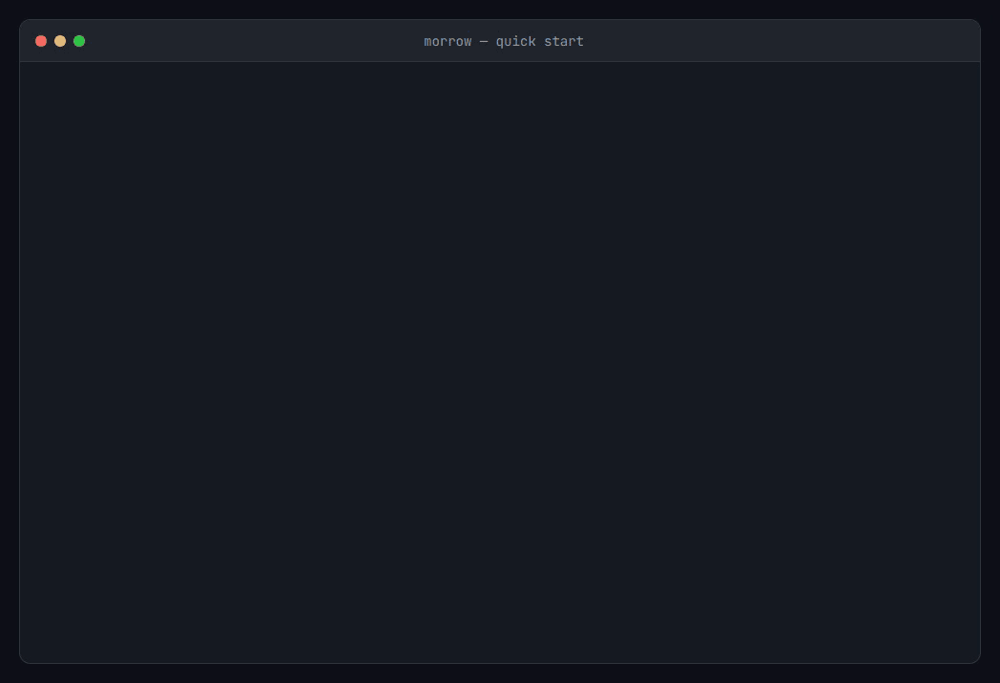
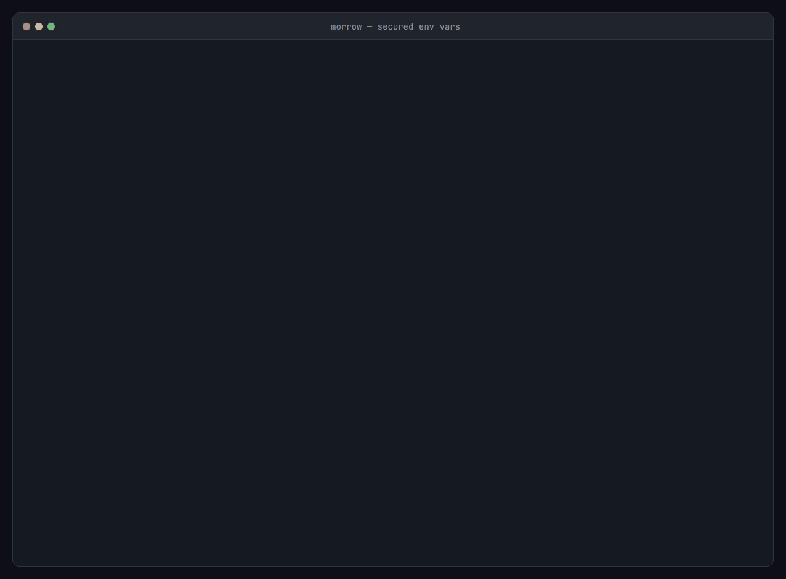

# Morrow: Simple Cross Platform Process Manager

## Getting Started

### 1. Building from Source
This project uses a unified Make-based build system that compiles binaries for multiple platforms (Windows and Linux) and builds WiX installers (`.msi`).

**Requirements:**
- Go (1.27.3+)
- Make (`GNU Make`)
- .NET SDK (for building WiX installers via `dotnet build`)
- PowerShell (used internally by Makefile for cross-platform scripts on Windows)

**Building:**
```bash
# Build everything (Go binaries and MSI installers)
make all

# Build only Go binaries
make build-go

# Clean build artifacts
make clean
```
All build outputs are output flatly into the `/dist/v<version>/` directory.
Each file is distinctly named using the `morrow-v<version>_<platform>` schema.

**Supported Targets:**
- **Windows**: x64, x86, ARM64 (plus `.msi` installers)
- **Linux**: amd64 (x86_64), arm64 (aarch64), arm (v7/32-bit)

**Versioning:**
The project uses a single source of truth for its version: the `build.xml` file.
```bash
# Update the project version automatically
make set-version V=1.1.0

# Then rebuild to apply the new version to directories, WiX files, and binaries
make all
```

### 2. Initialization
Morrow requires an initial setup to create its database and encryption keys.

**System install** (data next to the binary, e.g. `/usr/local/bin` or `C:\Program Files\Morrow`) must be initialized elevated, so the database and key are owned by root/Administrators:
```bash
sudo morrow init        # Linux/macOS
morrow init             # Windows: from an Administrator terminal
```
Afterwards, regular users can still run read-only commands (`list`, `status`, `detail`, `list-env`), while changes (`create`, `start`, `stop`, `set-env`, ...) and secured values require sudo/Administrator.

**Per-user install** needs no elevation: point `MORROW_HOME` at a directory you own.
```bash
export MORROW_HOME="$HOME/.morrow"
morrow init
```

Re-running `init` on an existing install is safe: it keeps the key and re-applies its access restrictions.

### 3. Basic Usage


Register a new application and start it. On a system install, commands that change state need `sudo` (Windows: an Administrator terminal); read-only commands don't. In per-user mode (`MORROW_HOME`), drop the `sudo`.
```bash
# Create the app (Morrow flags such as -w go before the app name;
# everything after the executable is passed to the app as-is)
sudo morrow create -w /path/to/workdir my-app /path/to/executable --port 8080

# Start it
sudo morrow start my-app

# Check status (read-only, no sudo needed)
morrow list
```

## Command List
| Descriptions | Commands |
| --- | --- |
| Initialize Morrow (sudo / Administrator, unless `MORROW_HOME` is set) | `morrow init [--force]` |
| Set environment variable | `morrow set-env <app-name> <key=value> [key2=value2]...` |
| Get environment variable | `morrow get-env <app-name> <env-name>` |
| Delete environment variable | `morrow del-env <app-name> <env-name>` |
| List environment variables | `morrow list-env <app-name>` |
| List All Applications | `morrow list` |
| Create Application | `morrow create [-w <workdir>] <app-name> <exec-path> <args...>` |
| Delete Application | `morrow delete <app-name>` |
| Start Application | `morrow start <app-name> [-e KEY=VALUE...]` |
| Stop Application | `morrow stop <app-name>` |
| Restart Application | `morrow restart <app-name>` |
| Update Application | `morrow update [-w <workdir>] <app-name> <exec-path> <args...>` |
| Get Application Status | `morrow status <app-name>` |
| Get Application Detail | `morrow detail <app-name>` |
| Get Application Logs | `morrow logs <app-name>` |

## Detail Application Example
By default, this command outputs a human-readable table. Use the `--json` flag for programmatic integration. Secured variables are always shown as `****` here; the real value is only passed to the process.



The outputs below are real, captured on Linux (system install; `detail` run as a regular user, without sudo) after:
```bash
sudo morrow create -w /tmp/demo/api api /tmp/demo/bin/demo-api --port 8080
sudo morrow set-env api API_TOKEN:s=s3cr3t-demo-token LOG_LEVEL=info
sudo morrow start api
```

### Default Terminal Table
**Command:**
```bash
morrow detail api
```

**Result:**
```text
+----------------------------+------------------------------------------+
| Field                      | Value                                    |
+----------------------------+------------------------------------------+
| Application ID             | 1438888c-1a40-4658-a1a2-0469083b0493     |
| Application Name           | api                                      |
| Executable Path            | /tmp/demo/bin/demo-api                   |
| Arguments                  | --port 8080                              |
| Working Directory          | /tmp/demo/api                            |
| Full Command               | API_TOKEN=**** LOG_LEVEL=info /tmp/demo/bin/demo-api --port 8080 |
| Status                     | running                                  |
| PID                        | 288                                      |
| Creation Time              | 2026-10-27T09:24:24Z                     |
| Update Time                | 2026-10-27T09:24:27Z                     |
| Status Time                | 2026-10-27T09:24:27Z                     |
| Last Run Time              | 2026-10-27T09:24:27Z                     |
+----------------------------+------------------------------------------+
```

### JSON Output
**Command:**
```bash
morrow detail api --json
```

**Result:**
```json
{
  "application_id": "1438888c-1a40-4658-a1a2-0469083b0493",
  "application_name": "api",
  "application_executable_path": "/tmp/demo/bin/demo-api",
  "application_arguments": [
    "--port",
    "8080"
  ],
  "application_working_directory": "/tmp/demo/api",
  "application_environment_variables": {
    "API_TOKEN": "****",
    "LOG_LEVEL": "info"
  },
  "application_status": "running",
  "application_pid": 288,
  "application_creation_time": "2026-10-27T09:24:24Z",
  "application_update_time": "2026-10-27T09:24:27Z",
  "application_status_time": "2026-10-27T09:24:27Z",
  "application_last_run_time": "2026-10-27T09:24:27Z",
  "application_command_line": "API_TOKEN=**** LOG_LEVEL=info /tmp/demo/bin/demo-api --port 8080"
}
```

## Example
On a system install, prefix state-changing commands with `sudo` (Windows: run from an Administrator terminal). In per-user mode (`MORROW_HOME`), run them as-is.

### Python Application
```bash
# Run from the project folder so relative paths (config, .env, venv assets) resolve
morrow create -w /home/user/my-app py-app /home/user/my-app/.venv/bin/python main.py --port 8080
morrow start py-app
```

### Binary Application (Go/Rust/C/C++)
```bash
# Compiled Go binary
morrow create go-app /home/user/apps/go-server --config /etc/go-server.yaml
morrow start go-app

# Rust binary with environment variables
morrow create rust-app /usr/local/bin/api-service
morrow set-env rust-app RUST_LOG=info
morrow start rust-app

# Start with inline (non-permanent) environment variables
morrow start rust-app -e DEBUG=true -e LOG_LEVEL=warn
```

### General Management
```bash
# Set variables in bulk (mix secured and unsecured with :s and :u suffixes)
morrow set-env py-app DB_HOST=localhost DB_PORT=5432 API_KEY:s=secret_val
morrow status py-app
morrow detail py-app
morrow stop py-app
morrow delete py-app
```


## Architecture
### Sidecar Relay Pattern
Morrow implements a **Sidecar Relay Pattern** for robust process management. 

When an application is started:
1. **Relay Spawn**: Morrow launches a detached "relay" process for that specific application.
2. **Process Isolation**: The relay process detaches from the parent terminal session, ensuring the application continues running after the user logs out or closes the terminal.
3. **Log Management**: The relay handles real-time logging, piping the application's `stdout` and `stderr` to rotating log files (using the `lumberjack` library).
4. **State Sync**: The relay continuously synchronizes the application's status (running, stopped, crashed) with the Morrow database.

This ensures high availability and reliable log capture without requiring a heavy daemon to be running constantly in the background.

## Security
Morrow supports encrypted environment variable storage using the `--secured` (or `-s`) flag. 
- **Access follows the key file**: secured values are encrypted with the master key (`.morrow.key` next to the binary, or `MORROW_KEY_PATH`). Whoever can read that file can decrypt them. `init` restricts it to its owner (`0600` on Linux/macOS; on Windows an explicit ACL for SYSTEM + Administrators, or only the current user in per-user mode), so in a system install only root/Administrators can read secured values.
- **Back up the key**: only `morrow init` creates it, and secured values cannot be recovered without it. If the key is lost while secured variables exist, `init` refuses to create a new one and lists them; restore the original key file, or run `morrow init --force` to create a new key and delete those variables.
- **Censorship**: `detail` (table and `--json`, including the Full Command) always shows secured values as `****`. `list-env` shows them as `****` when the key is not readable; `get-env` and `start` fail with a clear error in that case.
- **Mixed Bulk Support**: You can override the default security setting per variable by suffixing the key:
    - `key:s=value` -> Force Secured (encrypted)
    - `key:u=value` -> Force Unsecured (plaintext)


